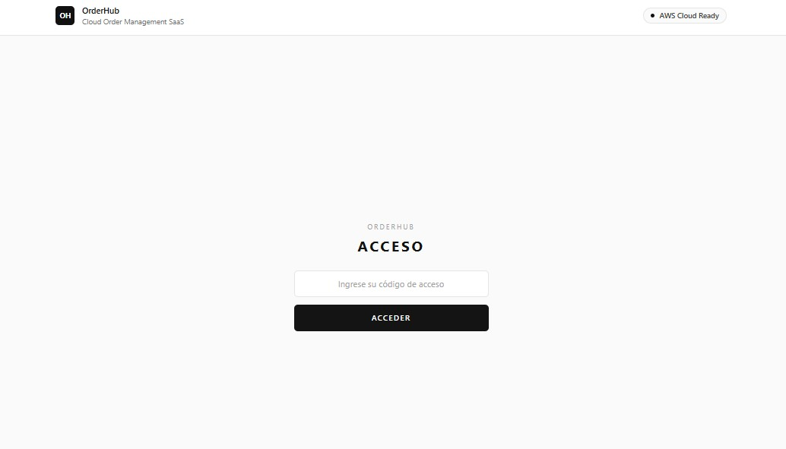
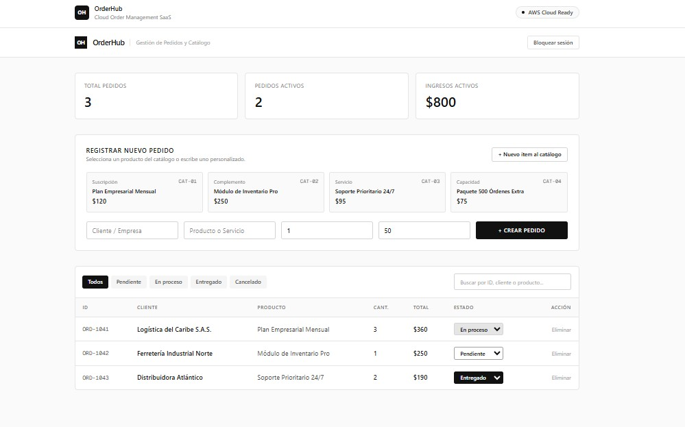
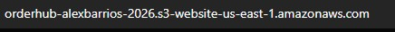

# OrderHub — Cloud Order Management SaaS

**OrderHub** es una plataforma SaaS liviana para la gestión centralizada de catálogo y pedidos comerciales en tiempo real, construida con **Next.js (React + TypeScript + Tailwind CSS)** y desplegada como aplicación web estática sobre **Amazon Web Services (AWS S3)** mediante integración y entrega continua con **GitHub Actions**.

---

## Dominio Público de la Aplicación

* **URL de Producción:** `http://orderhub-alexbarrios-2026.s3-website-us-east-1.amazonaws.com/` *(se actualizará con el dominio personalizado en el despliegue final)*
* **Código de Acceso Demo:** `ORDER2026`

---

## Características Principales

* **Control de Acceso Privado (`Access Gate`):** Pantalla inicial protegida mediante código de acceso antes de habilitar el panel operativo, gestionando la sesión activa con `sessionStorage`.
* **Catálogo Rápido de Productos y Servicios:** Selección directa de ítems preconfigurados o personalizados con autocompletado de producto y precio unitario, además de creación de nuevos ítems desde el panel.
* **Gestión Completa de Pedidos:**
  * Creación de pedidos con validación de campos y cálculo automático de totales.
  * Cambio dinámico de estados (`Pendiente`, `En proceso`, `Entregado`, `Cancelado`).
  * Búsqueda instantánea por ID, cliente o producto y filtrado por estado.
* **Métricas Operativas en Tiempo Real:** Cálculo automático de **Total Pedidos**, **Pedidos Activos** e **Ingresos Activos**.
* **Persistencia en el Navegador:** Almacenamiento sincronizado en `localStorage` para pedidos y catálogo, conservando los datos entre recargas sin depender de un servidor backend.
* **Interfaz Editorial Monocromática:** Diseño minimalista en blanco y negro (`#FAFAFA` / `#111111`) de alto contraste.

---
## Evidencia de Funcionamiento

### 1. Control de Acceso Privado (`Access Gate`)


### 2. Panel Operativo, Catálogo Rápido y Gestión de Pedidos


### 3. Despliegue Activo en AWS S3


## Flujo de la Aplicación y Estructura del Proyecto

### Flujo Operativo
1. **Autenticación (`sessionStorage`):** El usuario ingresa el código de acceso (`ORDER2026`) en la vista `ACCESO`.
2. **Hidratación de Datos (`localStorage`):** Se cargan el catálogo (`orderhub_catalog_v1`) y los pedidos (`orderhub_orders_v2`) almacenados localmente.
3. **Operación en el Dashboard:** El usuario selecciona o crea ítems del catálogo, registra nuevos pedidos, filtra/busca registros, actualiza estados y visualiza las métricas recalculadas en vivo.

### Estructura de Carpetas
```text
orderhub/
├── .github/
│   └── workflows/
│       └── deploy.yml          # Pipeline CI/CD para build y sincronización con AWS S3
├── app/
│   ├── globals.css             # Estilos globales y configuración de Tailwind CSS
│   ├── layout.tsx              # Estructura base HTML, metadatos y tipografía
│   └── page.tsx                # Control de acceso, catálogo rápido, dashboard y tabla de pedidos
├── docs/
│   └── screenshots/            # Capturas de evidencia del funcionamiento en producción
├── public/                     # Recursos estáticos públicos
├── next.config.ts              # Configuración de exportación estática (output: "export")
├── package.json                # Dependencias y scripts de desarrollo/compilación
└── README.md                   # Documentación técnica del proyecto